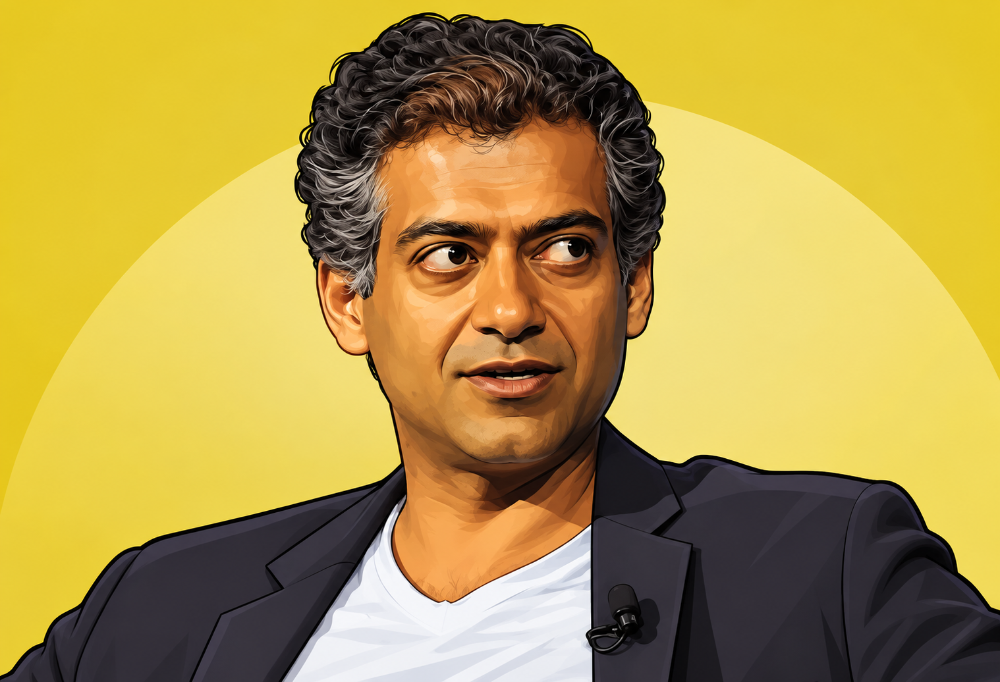

# Startup Advisors

**Five startup legends as AI advisors.** Their books, essays, talks, and tweets -- distilled into structured knowledge bases you can use with any AI tool.

<p align="center">
  
  
  
  
  
</p>

<table>
  <tr>
    <td align="center"><b>Paul Graham</b><br/><sub>YC / 50 Essays</sub><br/><code>Idea validation, early growth</code></td>
    <td align="center"><b>Alex Hormozi</b><br/><sub>$100M Offers</sub><br/><code>Offers, pricing, sales</code></td>
    <td align="center"><b>Peter Thiel</b><br/><sub>Zero to One</sub><br/><code>Monopoly, contrarian thinking</code></td>
    <td align="center"><b>Naval Ravikant</b><br/><sub>AngelList / Almanack</sub><br/><code>Leverage, specific knowledge</code></td>
    <td align="center"><b>Sahil Lavingia</b><br/><sub>Gumroad / TME</sub><br/><code>Bootstrapping, profitability</code></td>
  </tr>
</table>

## Quick Start

### Any AI Tool (Claude, ChatGPT, Cursor, etc.)

Each advisor has a **`PROMPT.md`** -- a universal system prompt. Copy-paste it into:

| Tool | Where to paste |
|---|---|
| Claude / ChatGPT | Custom instructions or system prompt |
| Cursor | `.cursorrules` or context file |
| Claude Code | Reference in `CLAUDE.md` |
| Any LLM API | System message |

For deeper context, attach the matching `references/` file alongside the prompt.

### [Hermes](https://github.com/nousresearch/hermes) (Full Experience)

**Install as skills** -- advisor knowledge in your default chat:
```bash
git clone https://github.com/DainoJung/startup-advisor-skill.git
for advisor in paul-graham alex-hormozi peter-thiel naval-ravikant sahil-lavingia; do
  cp -r startup-advisor-skill/advisors/$advisor ~/.hermes/skills/research/
done
```

**Create advisor bots** -- separate personalities + group debates:
```bash
./scripts/setup-hermes-bots.sh
```
> Open Hermes desktop -> BOTS tab. Right-click -> Manage groups to create a multi-advisor debate room.

### Claude Code
```bash
echo "See advisors/paul-graham/PROMPT.md for PG's frameworks" >> CLAUDE.md
```

## What's Inside

```
advisors/<name>/
├── PROMPT.md              # Universal system prompt (any AI tool)
│                          # Voice, frameworks, situation map, source links
├── SKILL.md               # Hermes-specific metadata (optional)
└── references/
    └── frameworks.md      # Full knowledge base
                           # Quotes, source URLs, self-diagnosis questions
```

## The Advisors

### Paul Graham
> *"Make something people want."*

50 essays distilled into 12 situation categories and ~70 core principles. Covers idea validation, early growth, survival, fundraising, motivation, competition, product decisions, scaling, and more.

**Sources:** [50 essays](http://paulgraham.com/articles.html) at paulgraham.com

### Alex Hormozi
> *"Make people an offer so good they feel stupid saying no."*

Frameworks from *$100M Offers* and *$100M Leads*. The Value Equation, Grand Slam Offer (7 layers), Core Four lead generation, Rule of 100, and the More->Better->New scaling framework.

**Sources:** [$100M Offers](https://www.acquisition.com/books), [$100M Leads](https://www.acquisition.com/books), [YouTube](https://youtube.com/@AlexHormozi)

### Peter Thiel
> *"Competition is for losers."*

Frameworks from *Zero to One* and Stanford CS183. Monopoly theory, the Secret Question, definite vs indefinite optimism, last mover advantage, power law, and the 7 questions every business must answer.

**Sources:** [Zero to One](https://www.amazon.com/Zero-One-Notes-Startups-Future/dp/0804139296), [CS183 Notes](https://blakemasters.tumblr.com/tagged/cs183)

### Naval Ravikant
> *"Seek wealth, not money or status."*

Frameworks from the "How to Get Rich" tweetstorm and *The Almanack of Naval Ravikant*. Three forms of leverage, specific knowledge, judgment, long-term games, and happiness as a skill.

**Sources:** [Almanack](https://www.navalmanack.com/) (free), [Tweetstorm](https://threadreaderapp.com/thread/1002103360646823936.html)

### Sahil Lavingia
> *"Profitability > Growth."*

Frameworks from *The Minimalist Entrepreneur* and Gumroad's real story -- the $8M raise, failed Series B, 75% layoff, and rebuild to profitability. Community-first, default alive, and the no-meetings operating model.

**Sources:** [The Minimalist Entrepreneur](https://www.amazon.com/Minimalist-Entrepreneur-Great-Founders-More/dp/0593192397), [Reflecting on My Failure](https://sahillavingia.com/reflecting)

## Contributing

Want to add an advisor? Follow the pattern:

1. Create `advisors/<name>/PROMPT.md` -- voice, frameworks, situation map
2. Create `advisors/<name>/references/frameworks.md` -- full knowledge base with quotes
3. **Every principle must cite its source** (book, essay, talk, or post)
4. Add a portrait to `assets/portraits/<name>.png` (illustrated style preferred)
5. Submit a PR

## License

Principles, quotes, and frameworks are from publicly available books, essays, talks, and social media. This repository is a structured reference for personal and educational use.

---

Built with [Hermes](https://github.com/nousresearch/hermes) by [@DainoJung](https://github.com/DainoJung)
